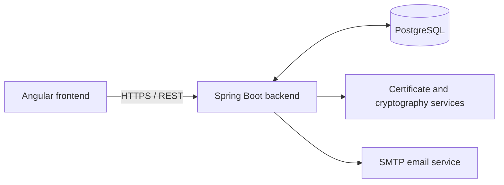

# Cybersecurity Project

An Information Security course project developed at the Faculty of Technical Sciences, University of Novi Sad. The repository contains two related but independent applications:

1. **Public Key Infrastructure (PKI)** - a web application for issuing, managing, exporting, and revoking X.509 digital certificates.
2. **LSB Steganography** - a Java console application exploring how messages can be hidden inside PNG images using sequential or password-dependent pixel selection.

The PKI system is the main project. The steganography application is a separate, smaller exploration of information hiding.

## PKI demonstration video

[**Watch the Public Key Infrastructure demo on YouTube**](https://youtu.be/RUC_CXfiMxI)

The video demonstrates PKI workflows in action, complementing the interface and certificate screenshots below.

## 1. Public Key Infrastructure (PKI)

The PKI application manages certificate authorities, organizations, users, certificate requests, and digital certificate lifecycles. It consists of an Angular frontend, a Spring Boot REST backend, and a PostgreSQL database.

### Main features

**Certificate management**

- Issue self-signed Root CA, Intermediate CA, and End-Entity certificates.
- Build multilevel certificate chains and validate the selected issuing certificate.
- Configure X.509 subject information, validity periods, key usage, Basic Constraints, and subject alternative names.
- List and inspect certificates within the scope of each user's permissions.
- Export certificates as PEM files or download certificate material together with a private key in PKCS#12 format when supported by the relevant workflow.
- Revoke certificates with an X.509 revocation reason and inspect revocation status through CRL and OCSP-style endpoints.

**Users and authentication**

- Three access levels: Administrator, CA User, and regular User.
- Administrator management of organizations, CA users, and certificates across the system.
- Organization-scoped certificate operations for CA users.
- Registration, account activation, and password recovery workflows for regular users, including public-key challenges handled with browser-side cryptography.
- Authentication with access and refresh tokens, role-based authorization, and optional TOTP-based two-factor authentication.

**Certificate requests and key handling**

- Submit an externally generated Certificate Signing Request (CSR) for review by a CA user.
- Approve or reject pending certificate requests.
- Automatically generate an End-Entity certificate and key pair, with an immediate PKCS#12 download.
- Encrypt stored certificate private keys using organization-specific keys and a master-key hierarchy.
- Periodically rotate master keys while migrating the organization keys encrypted under them.
- Serve the backend over HTTPS, including local certificate and revocation URLs.

### Architecture



The Spring Boot application implements authorization, certificate generation and revocation, CSR processing, key management, and persistence. The Angular application provides separate workflows for the three user roles.

### Screenshots

<details open>
<summary><strong>Login and role-based dashboards</strong></summary>

**Login page**


**Administrator dashboard**


**CA user dashboard**


**Regular user dashboard**


</details>

<details>
<summary><strong>Organization and CA user administration</strong></summary>

The administrator can create organizations and manage the CA users assigned to them.

**Organization management**


**CA user management**


</details>

<details>
<summary><strong>Certificate issuance, export, and revocation</strong></summary>

**Certificate overview** - issued certificates, validity information, export, and revocation actions.


**Issue certificate** - certificate type, issuer, and subject information.


**Issue certificate details** - validity dates, subject alternative name, and certificate capabilities.


**Revocation tools** - OCSP status checks and CRL inspection.


**Exported X.509 certificate inspection** - certificate subject, issuer, validity, RSA public key, and extensions shown using Windows `certutil`.


**CRL and OCSP references** - distribution and status-check URLs embedded in the exported certificate.


</details>

<details>
<summary><strong>Regular user certificate requests</strong></summary>

Regular users can either generate a new End-Entity certificate through the application or upload a CSR created with an external tool.

**Automatic certificate generation**


**External CSR upload**


</details>

### Certificate and revocation workflow

A typical workflow starts with a Root CA certificate, followed by issuing Intermediate CA or End-Entity certificates. An externally created CSR can also be submitted and approved by a CA user. After issuance, the resulting certificate can be inspected or exported. If revoked, its updated status can be checked through the revocation tools or the URLs embedded in its X.509 extensions.

Local development endpoints include:

```text
https://localhost:8443/api/revocation/ocsp/{certificateSerialNumber}
https://localhost:8443/api/revocation/crl/{issuerSerialNumber}
```

The project's OCSP-style endpoint returns a JSON status response rather than a binary RFC 6960 OCSP response.

### Running the PKI application locally

**Requirements:** Java 17, PostgreSQL, Node.js/npm, and a browser.

1. Create a PostgreSQL database named `pki_db` and configure the connection in `backend/src/main/resources/application.properties`.
2. Set the environment variables `MASTER_KEY`, `MAIL_USERNAME`, and `MAIL_PASSWORD` for the backend. `MASTER_KEY` is used as an AES key and must have a valid AES key length (16, 24, or 32 bytes in the application's current key-loading implementation).
3. Start the Spring Boot backend from the `backend` directory:

   ```powershell
   .\mvnw.cmd spring-boot:run
   ```

4. In another terminal, start the Angular frontend from the `frontend` directory:

   ```bash
   npm install
   npm start
   ```

5. Open `http://localhost:4200`. The backend is configured for `https://localhost:8443`.

The repository includes a development HTTPS keystore. Your browser must trust the corresponding test CA for HTTPS requests to succeed. The current JPA setting, `spring.jpa.hibernate.ddl-auto=create-drop`, recreates the development database schema when the backend runs.

## 2. LSB Steganography

This standalone Java console application explores **Least Significant Bit (LSB) steganography** in PNG images. It hides UTF-8 text in the least significant bits of RGB color channels, preserving the original image dimensions and making the changes difficult to notice visually.

### Supported operations

- **Sequential LSB embedding:** write the message length and message bits sequentially into RGB channel LSBs.
- **Sequential LSB extraction:** reconstruct the hidden message from the encoded PNG.
- **Image capacity calculation:** report image dimensions and the available payload size.
- **Random LSB embedding:** distribute the message bits across image positions determined by a password.
- **Random LSB extraction:** use the matching password to reconstruct the message.

In Random LSB mode, a SHA-256 hash of the password is used to derive a seed for a deterministic pseudorandom ordering of RGB positions. This changes where the bits are stored; it is not encryption of the message itself.

### Visual comparison


The screenshot places the **original PNG on the left** and the **stego PNG on the right**. The cat looks essentially identical in both images even though data has been embedded into its RGB channels.

The file information visible at the bottom is also worth noting: the original is approximately **2.45 MB**, while the stego image is approximately **2.77 MB**. That difference reflects how the modified pixel values affect lossless PNG compression; it does not mean there is an equally large visible change in the image. The image remains 1536 x 1024 pixels.

### Console demonstration


The console shows the sequential embedding workflow, a large test message, the selected input and output PNG files, and confirmation that the hidden data was saved. The menu also exposes the Random LSB operations, which require a password for both embedding and extraction.

### Running the steganography application

From the `Steganography/steganography` directory, compile and run the plain Java sources:

```bash
javac -d out src/*.java
java -cp out Main
```

Alternatively, open the Java project in Eclipse and run `Main.java`.

The repository includes sample PNG images under:

```text
Steganography/steganography/images/original/
Steganography/steganography/images/stego/
```

Image paths entered in the console are resolved relative to the application's working directory. PNG is used because its lossless encoding preserves the pixel LSB values required for extraction.

## Repository structure

```text
Cybersecurity-Project/
├── backend/                 Spring Boot PKI REST API
├── frontend/                Angular application
├── Steganography/
│   ├── steganography/       Java LSB steganography application
│   └── *.pptx               Steganography presentation
├── docs/
│   └── images/              Screenshots of both applications
└── README.md
```

## Technologies

| PKI system | Steganography |
| --- | --- |
| Java 17, Spring Boot, Spring Security | Java 17 |
| Angular, TypeScript, HTML, CSS | Java AWT `BufferedImage` |
| PostgreSQL, Spring Data JPA | PNG image processing |
| X.509, RSA, AES, PKCS#12 | Sequential and password-dependent LSB |
| JWT, TOTP, HTTPS | SHA-256-based position selection |
| Bouncy Castle | UTF-8 message encoding |

## Authors

Developed as a team project for the Information Security course:

- [Nikola Savić](https://github.com/nikolasa004)
- [Branislav Marković](https://github.com/bane-31)
- [Uroš Milinović](https://github.com/UrosMilinovic)
